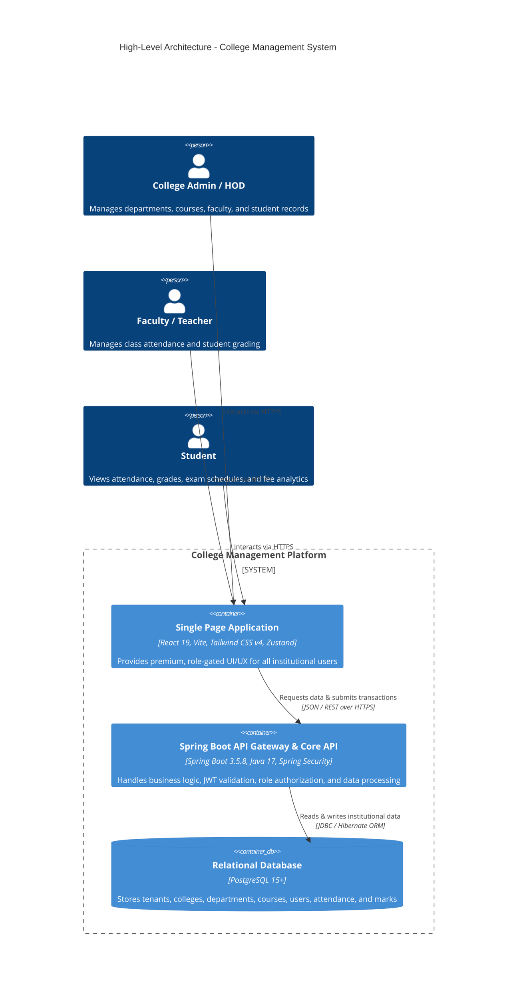
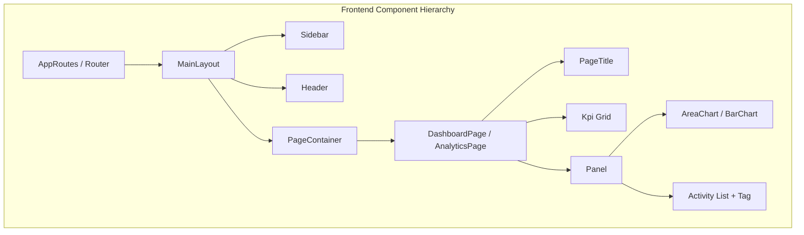
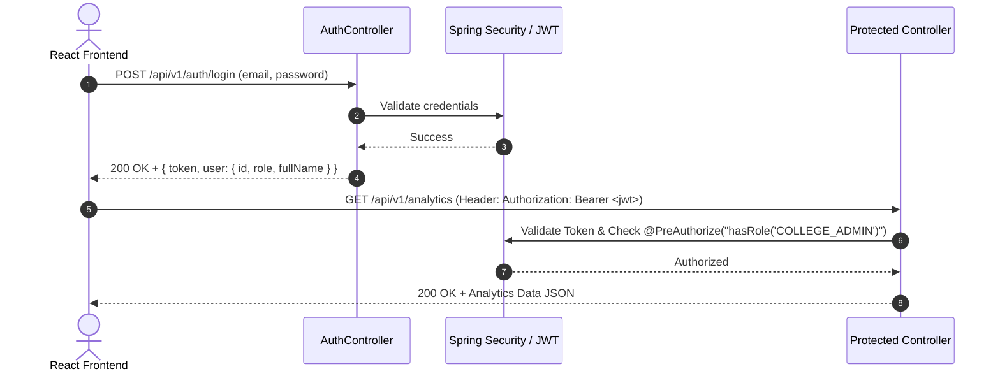

# College Management System - System Design

## 1. High-Level Architecture (HLA)

The College Management System is structured as a decoupled, multi-tier Web Application following modern enterprise standards. It separates the presentation layer (React 19 / TypeScript) from the business logic and persistence layer (Spring Boot 3.5 / Java 17 / PostgreSQL), communicating over secure REST APIs with JWT-based authentication.

### 1.1 Core Architectural Principles
1. **Decoupled Client-Server Interaction**: The React client acts as an autonomous consumer of the Spring Boot REST API. State management is strictly divided between client-side UI state (Zustand) and remote server state (TanStack Query v5).
2. **Role-Based Access Control (RBAC)**: All endpoints and UI routes are protected by role-specific validation strategies (SuperAdmin, CollegeAdmin, HOD, Teacher, Student).
3. **Database Migration & Schema Evolution**: Managed declaratively via Liquibase changelogs to ensure reliable, version-controlled schema transitions across environments.

---

## 2. Low-Level Design (LLD)

### 2.1 Frontend Architecture & UI Design System
Inspired by the premium "Institutional Ledger" aesthetic from the reference project, the frontend adopts a highly refined, professional design system.

#### 2.1.1 Color Palette & Typography (OKLCH)
- **Background & Surface**: Clean zinc/slate tones (`oklch(0.985 0.002 247)` for light mode, `oklch(0.16 0.02 265)` for dark mode).
- **Accents & Interactivity**: Precise purples/blues (`oklch(0.55 0.2 264)` / `oklch(0.24 0.03 265)`) ensuring strong contrast and premium visual hierarchy.
- **Typography**: Inter font with advanced OpenType features (`cv02`, `cv03`, `cv04`, `cv11`, `ss01`) and tabular numbers (`tabular-nums`) for perfect alignment in data tables and KPI metrics.

#### 2.1.2 Component Hierarchy & UI Kit
To ensure consistency and reusability, all pages compose primitives from a central UI Kit:
- `PageContainer`: Standardized padding, max-width constraints (`max-w-[1600px]`), and responsive overflow management.
- `PageTitle`: Unified header with title, subtitle, and dynamic action slots (buttons, dropdowns).
- `Kpi`: High-impact metric cards with delta indicators (`+2.4%`, `-0.8%`) and semantic color coding (up, down, muted).
- `Panel`: Card enclosures with optional header actions and clean border-radius (`rounded-xl`).
- `Tag`: Status pills with five semantic tones (`neutral`, `green`, `amber`, `red`, `blue`).
- `AreaChart` & `BarChart`: Lightweight, responsive SVG-based visualizers for fee trends, attendance averages, and mark distributions.

### 2.2 Backend Architecture & Domain Model

#### 2.2.1 Layered Package Structure
The backend follows a rigorous package-by-layer/feature architecture under `com.collegeManagement.production`:
- `controller/`: REST controllers defining OpenAPI contracts and role-based pre-authorization annotations (`@PreAuthorize`).
- `service/`: Transactional business logic layer orchestrating entity persistence and validation.
- `repository/`: Spring Data JPA repositories with optimized JPQL queries.
- `entity/`: JPA entities with robust auditing (`@CreatedDate`, `@LastModifiedDate`).
- `dto/`: Immutable data transfer objects mapped automatically via MapStruct.
- `exception/`: Global `@ControllerAdvice` handling exceptions and returning standardized RFC 7807 error responses.

#### 2.2.2 Security & Authentication Flow
1. **Login Request**: Client sends credentials to `/api/v1/auth/login`.
2. **Token Issuance**: Backend verifies credentials and issues a signed JWT containing user claims (ID, email, role, tenant).
3. **Authorized Requests**: Client attaches `Authorization: Bearer <JWT>` header to subsequent requests. `JwtAuthenticationFilter` validates the token and populates the `SecurityContext`.

---

## 3. Test Strategy & Verification Plan

Before modifying existing implementation logic, robust success and failure test cases must be established and verified.

### 3.1 Backend Test Cases
1. **Success Scenarios**:
   - Verify JWT generation and successful validation for valid credentials.
   - Verify successful retrieval of college, department, and attendance metrics with valid authorization headers.
   - Verify successful persistence of new student/faculty records with valid DTO payloads.
2. **Failure Scenarios**:
   - Verify 401 Unauthorized response when accessing protected endpoints without a token or with an expired token.
   - Verify 403 Forbidden response when a user with `STUDENT` role attempts to access `COLLEGE_ADMIN` endpoints.
   - Verify 400 Bad Request response when submitting invalid payload data (e.g., missing required fields, invalid email format).
   - Verify 404 Not Found response when requesting non-existent entities by ID.

### 3.2 Frontend Test Cases
1. **Success Scenarios**:
   - Verify successful rendering of `MainLayout`, `Sidebar`, and `Header` with user session data.
   - Verify correct navigation filtering based on the active user's role strategy.
   - Verify successful rendering of UI Kit components (`Kpi`, `Panel`, `AreaChart`, `BarChart`, `Tag`) with mock datasets.
2. **Failure Scenarios**:
   - Verify automatic redirection to `/login` when accessing protected routes without an active session.
   - Verify rendering of the `403 Unauthorized` fallback view when accessing routes outside the allowed role strategy.
   - Verify graceful error boundary rendering when an unexpected rendering error occurs.
