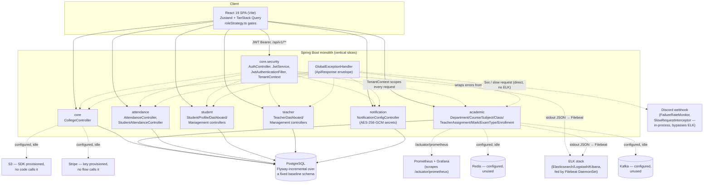
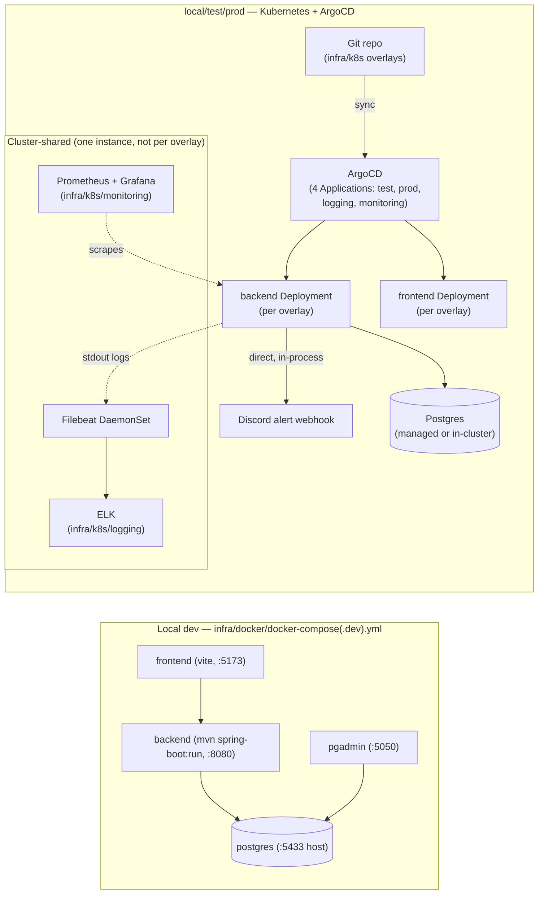

# Architecture & Decision Log

## Overview
Feature-vertical monolith backend + SPA frontend, multi-tenant by college.

- **Backend:** Spring Boot 3.5.8 / Java 17 / Maven. Packages under
  `com.edgepoint` are vertical slices (`core`, `academic`, `attendance`,
  `student`, `teacher`, `notification`), each with its own
  `controller/domain/dto/repository/service` — no shared layer-wide package
  except `core` (auth, tenancy, shared entities, error handling). Full tree
  in [docs/ProjectStructure.md](../ProjectStructure.md).
- **Frontend:** React 19 + Vite + TypeScript. Zustand for auth/session
  state, TanStack Query v5 for data fetching, TanStack Table v8, Zod +
  React Hook Form for validation. Three client-side strategy layers
  (query-key factory, action/permission gate, route guard) all read from one
  source of truth, `frontend/src/strategies/roleStrategy.ts` — see
  [docs/ACCESS_CONTROL.md](../ACCESS_CONTROL.md) for how they compose.
- **Auth & tenancy:** JWT (HS256) issued by `AuthService`, validated by
  `JwtAuthenticationFilter`. `TenantContext` carries college/department
  scope extracted from the token through the request. Role hierarchy
  `SUPERADMIN > COLLEGEADMIN > HOD > TEACHER | STUDENT` enforced via
  `@PreAuthorize` per controller — the actual authorization boundary (the
  frontend strategies are UX only).
- **Data:** PostgreSQL. Baseline schema applied once via
  `infra/k8s/base/db/init-db.sql` (Hibernate runs `ddl-auto: validate` in
  test/prod, never creates tables there); Flyway (`db/migration/V*.sql`)
  carries incremental changes — as of 2026-10-06 this includes `V2`/`V3`,
  which finally cover every table/column `validate` needs (see "Key
  decisions" below; this replaced the `ddl-auto: update` stopgap that used
  to be required in the test/prod k8s overlays). See
  [docs/DatabaseMigration.md](../DatabaseMigration.md).
- **Secrets:** per-college SMTP/WhatsApp credentials encrypted at rest via
  AES-256-GCM (`EncryptedStringConverter`), key from `ENCRYPTION_KEY` env var.
- **Observability:** logs are structured JSON to stdout
  (`logback-spring.xml`) — the app itself never pushes to Logstash (a prior
  `LogstashTcpSocketAppender` was deliberately removed). In k8s, a Filebeat
  DaemonSet (`infra/k8s/logging/filebeat.yaml`) ships that stdout to
  Logstash → Elasticsearch, with Kibana on top (`infra/k8s/logging/elk.yaml`)
  — this is new as of 2026-10-06; previously `elk.yaml` was deployed-but-
  unwired (not in any overlay's kustomization) and nothing fed it logs.
  Metrics are Prometheus-format at `/api/v1/actuator/prometheus`
  (`micrometer-registry-prometheus`), scraped by `infra/k8s/monitoring`
  (Prometheus + Grafana, also new 2026-10-06 — previously nothing scraped
  this endpoint at all). Discord webhook alerts on failure-rate/slow-request
  thresholds are a separate, in-process path (`FailureRateMonitor`/
  `SlowRequestInterceptor` fed directly by `GlobalExceptionHandler`/a
  `HandlerInterceptor`) — **not** routed through ELK, unlike what the old
  version of this diagram implied. See
  [docs/OBSERVABILITY.md](../OBSERVABILITY.md).
- **Infra:** Docker Compose for local dev (`infra/docker/`); Kubernetes +
  ArgoCD for test/prod deployment plus a cluster-shared logging/monitoring
  stack (`infra/k8s`, `infra/argocd`). See
  [docs/LOCAL_K8S_DEPLOYMENT_RUNBOOK.md](../LOCAL_K8S_DEPLOYMENT_RUNBOOK.md),
  [docs/OPERATIONS.md](../OPERATIONS.md).
- **Provisioned but unused:** Redis and Kafka connection settings exist in
  `application.yml`; nothing in the codebase currently uses either. Stripe
  API key/webhook secret and the AWS S3 SDK (`backend/pom.xml`) are
  provisioned; no payment flow or file-storage code calls them yet.

## System diagram (HLD)

Dotted edges are cross-cutting (tenancy scoping, logging, alerting, or
configured-but-unused integrations) rather than direct request flow. ELK and
Discord are two independent observability paths, not a pipeline — Discord
alerts never go through ELK.

## Deployment diagram (HLD)

See [docs/LOCAL_K8S_DEPLOYMENT_RUNBOOK.md](../LOCAL_K8S_DEPLOYMENT_RUNBOOK.md)
for the actual overlay-by-overlay deploy sequence — this diagram is the
one-screen map, not a replacement for that runbook.

## Key decisions (append-only log, newest first)
- 2026-10-31: Security config hardening. (1) CORS reads `app.cors.allowed-origins` (env
  `APP_CORS_ALLOWED_ORIGINS`) instead of allowing every origin with credentials; production goes
  through the frontend nginx proxy on the same origin, so it needs no extra origins. (2) Actuator:
  `health` (+ liveness/readiness) and `info` stay public for k8s probes and the build-version
  footer; `health` hides details unless the caller is SUPERADMIN; every other actuator endpoint
  is SUPERADMIN-only. `prometheus` stays unauthenticated because the in-cluster scraper has no
  credentials, and `frontend/nginx.conf` refuses to proxy any actuator path except `info`, so it
  is not reachable from outside. Chosen over scrape credentials (more secrets to rotate) and a
  separate management port (needs probe and scrape config changes in every overlay). (3) springdoc
  is off by default and on in the `dev` profile only. (4) `JWT_SECRET` and
  `SPRING_DATASOURCE_PASSWORD` have no hard-coded fallbacks: startup fails without them, except
  that `dev`/`test` (and the dev compose file) set `app.security.ephemeral-jwt-key=true` to sign
  with a random per-process key. (5) CSP, Referrer-Policy, HSTS (HTTPS only) and frame-ancestors
  headers set explicitly. Still active.
- 2026-10-30: Entity audit capture writes in the **business transaction**, as one batch.
  Before, every Hibernate post-insert/update called a `REQUIRES_NEW` service that borrowed a
  second pool connection, opened and committed its own transaction and looked the actor up in
  `users` — N of each for an N-row save (a 60-student register), so ~20 concurrent bulk saves
  could starve the 20-connection Hikari pool. Options weighed:
  (A, chosen) buffer entries per Hibernate session and insert them as one JDBC batch in a
  `BeforeTransactionCompletionProcess` (after Hibernate's final flush, on the same connection,
  inside a savepoint so an audit failure is logged and rolled back alone, never failing the
  business commit). Audit rows commit exactly when the business change commits; a rolled-back
  change leaves no row, because it never happened.
  (B) collect during the transaction and write once in `afterCompletion` via one `REQUIRES_NEW`:
  rows survive rollback, but then record changes that never took effect (there is no `outcome`
  column to say so), still need a second connection per transaction, and are lost if the
  process dies between the business commit and the audit write.
  (C) A plus a separate `FAILED`-outcome entry for rolled-back attempts: needs an `outcome`
  column first (the audit standard asks for one); left as a follow-up.
  The actor username now comes from the authenticated JWT subject (`SecurityContextHolder`)
  instead of a `users` lookup per row. Login success/failure entries keep `REQUIRES_NEW`: a
  failed login rolls back and must still be recorded. Still active.
- 2026-10-06: Closed the gap between this doc set and the actual infra/observability code:
  (1) added Flyway `V2`/`V3` migrations covering every table/column `ddl-auto: validate` needs
  (subjects/classes/marks/attendance/etc. plus a `courses` drift fix), so the `ddl-auto: update`
  stopgap in the test/prod k8s overlays is gone — verified by booting the app against a real
  Postgres with `validate` after applying the migrations; (2) wired `infra/k8s/logging/elk.yaml`
  into a Filebeat DaemonSet + its own ArgoCD Application (it was deployed-but-unfed before);
  (3) added `infra/k8s/monitoring` (Prometheus + Grafana) scraping the previously-unscraped
  `/actuator/prometheus` endpoint; (4) gave test and prod distinct (still-placeholder) secrets
  instead of sharing one set; (5) fixed the broken/orphaned `application-dev.yml` profile into a
  working zero-dependency H2 local option; (6) deleted stale doc duplicates (`APIdoc.md`,
  `User-Guide.md`) and the stale root `docker-compose*.yml`/`docker/` duplicates of
  `infra/docker/`; (7) added a Jenkinsfile test→prod promotion gate (previously one
  unconditional update fed both). Still active.
- 2026-09-24: Per-college notification config (SMTP + WhatsApp) added with a
  split-privilege model — SUPERADMIN can read and write, COLLEGEADMIN can
  only read — because notification credentials are platform-sensitive
  (shared delivery infrastructure) even though they're scoped per college.
  Still active.
- 2026-10-19: Per-event channel routing (`notification_channel_rules`, V4)
  added. Unlike the credentials above, COLLEGEADMIN can write these for their
  own college — they only choose *which* channel carries an event, not the
  shared delivery credentials. Still active.
- 2026-10-19: `NotificationDispatcher` added. Producers publish a
  `NotificationMessage` Spring event; the dispatcher (`@Async`, AFTER_COMMIT)
  sends via `SmtpEmailSender` / `WhatsAppCloudSender` only when rule + college
  config + recipient address all allow it. Chosen over sync send (slow SMTP
  would block requests) and a persisted outbox (more work); trade-off: a
  failed send is logged and lost, no retry. Known gap: WhatsApp free-form
  text only reaches users inside Meta's 24h window — business-initiated
  sends need approved templates. Wired so far: ATTENDANCE_ABSENCE only.
  Still active.
- 2026-09-24: Marks/attendance/enrollment pipeline added; k8s environment
  configs fixed; observability (ELK) + Discord failure/slow-request
  alerting added. Still active.
- 2026-09-23: Role-based access control architecture introduced
  (`roleStrategy.ts` + `@PreAuthorize` matrix), UI modernized, numerous
  data/auth bugs fixed. Still active — this is the current permission model
  referenced throughout [requirements.md](requirements.md) and
  [contracts.md](contracts.md).
- 2026-07-06: Migrated build tooling from Gradle to Maven; workspace
  cleaned up. Superseded the prior Gradle-based build entirely — no Gradle
  files should remain; treat any reappearance as a regression.
- 2026-03-03: UI updates, RBAC introduced (predecessor of the 2026-09-23
  RBAC architecture pass above). Superseded by the 2026-09-23 entry.

## Known structural issues (found, not yet fixed)
- Resolved (2026-10-31): `frontend/src/components/edgepoint/` was a
  disconnected prototype tree (role portals, student/faculty views,
  fee/billing UI) not imported from any route. Deleted along with its only
  dependants (`api/institution.ts`, `lib/session.ts`, `lib/mock-data.ts`);
  the billing ideas are noted in [vision.md](vision.md) scope.
- Resolved (2026-10-06): `docs/APIdoc.md` and `docs/User-Guide.md` were
  duplicates/stale forks of `docs/API.md` and `docs/USER_GUIDE.md` — both
  deleted, the latter two are now the sole canonical copies.
