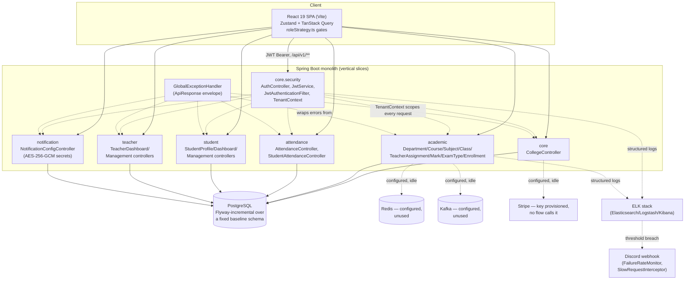
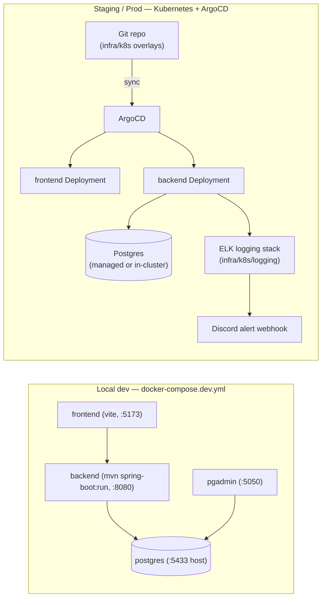

# Architecture & Decision Log

## Overview
Feature-vertical monolith backend + SPA frontend, multi-tenant by college.

- **Backend:** Spring Boot 3.5.8 / Java 17 / Maven. Packages under
  `com.edgepoint` are vertical slices (`core`, `academic`, `attendance`,
  `student`, `teacher`, `notification`), each with its own
  `controller/domain/dto/repository/service` — no shared layer-wide package
  except `core` (auth, tenancy, shared entities, error handling). Full tree
  in [docs/ProjectStructure.md](../ProjectStructure.md).
- **Frontend:** React 19 + Vite + TypeScript. Zustand for auth/session
  state, TanStack Query v5 for data fetching, TanStack Table v8, Zod +
  React Hook Form for validation. Three client-side strategy layers
  (query-key factory, action/permission gate, route guard) all read from one
  source of truth, `frontend/src/strategies/roleStrategy.ts` — see
  [docs/ACCESS_CONTROL.md](../ACCESS_CONTROL.md) for how they compose.
- **Auth & tenancy:** JWT (HS256) issued by `AuthService`, validated by
  `JwtAuthenticationFilter`. `TenantContext` carries college/department
  scope extracted from the token through the request. Role hierarchy
  `SUPERADMIN > COLLEGEADMIN > HOD > TEACHER | STUDENT` enforced via
  `@PreAuthorize` per controller — the actual authorization boundary (the
  frontend strategies are UX only).
- **Data:** PostgreSQL. Baseline schema applied once via
  `docker/postgres/init-db.sql` (Hibernate runs `ddl-auto: validate`, never
  creates tables); Flyway (`db/migration/V*.sql`) carries incremental changes
  only. See [docs/DatabaseMigration.md](../DatabaseMigration.md).
- **Secrets:** per-college SMTP/WhatsApp credentials encrypted at rest via
  AES-256-GCM (`EncryptedStringConverter`), key from `ENCRYPTION_KEY` env var.
- **Observability:** ELK (Elasticsearch/Logstash/Kibana) for logs, Discord
  webhook alerts on failure-rate/slow-request thresholds. See
  [docs/OBSERVABILITY.md](../OBSERVABILITY.md).
- **Infra:** Docker Compose for local dev; Kubernetes + ArgoCD for
  deployment (`infra/k8s`, `infra/argocd`). See
  [docs/LOCAL_K8S_DEPLOYMENT_RUNBOOK.md](../LOCAL_K8S_DEPLOYMENT_RUNBOOK.md),
  [docs/DEVOPS.md](../DEVOPS.md), [docs/OPERATIONS.md](../OPERATIONS.md).
- **Provisioned but unused:** Redis and Kafka connection settings exist in
  `application.yml`; nothing in the codebase currently uses either. Stripe
  API key/webhook secret are provisioned; no payment flow calls them yet.

## System diagram (HLD)

Dotted edges are cross-cutting (tenancy scoping, logging, alerting, or
configured-but-unused integrations) rather than direct request flow.

## Deployment diagram (HLD)

See [docs/LOCAL_K8S_DEPLOYMENT_RUNBOOK.md](../LOCAL_K8S_DEPLOYMENT_RUNBOOK.md)
for the actual overlay-by-overlay deploy sequence — this diagram is the
one-screen map, not a replacement for that runbook.

## Key decisions (append-only log, newest first)
- 2026-09-24: Per-college notification config (SMTP + WhatsApp) added with a
  split-privilege model — SUPERADMIN can read and write, COLLEGEADMIN can
  only read — because notification credentials are platform-sensitive
  (shared delivery infrastructure) even though they're scoped per college.
  Still active.
- 2026-09-24: Marks/attendance/enrollment pipeline added; k8s environment
  configs fixed; observability (ELK) + Discord failure/slow-request
  alerting added. Still active.
- 2026-09-23: Role-based access control architecture introduced
  (`roleStrategy.ts` + `@PreAuthorize` matrix), UI modernized, numerous
  data/auth bugs fixed. Still active — this is the current permission model
  referenced throughout [requirements.md](requirements.md) and
  [contracts.md](contracts.md).
- 2026-07-06: Migrated build tooling from Gradle to Maven; workspace
  cleaned up. Superseded the prior Gradle-based build entirely — no Gradle
  files should remain; treat any reappearance as a regression.
- 2026-03-03: UI updates, RBAC introduced (predecessor of the 2026-09-23
  RBAC architecture pass above). Superseded by the 2026-09-23 entry.

## Known structural issues (found, not yet fixed)
- `frontend/src/components/edgepoint/` is a disconnected prototype tree
  (role portals, student/faculty views, fee/billing UI) not imported from
  any route in `frontend/src/routes/index.tsx`. Decide whether to delete it
  or migrate its ideas (billing UI in particular) into the real app before
  it rots further out of sync with `roleStrategy.ts`.
- `docs/API.md` and `docs/APIdoc.md` appear to be duplicate files (identical
  title/TOC) — same for `docs/User-Guide.md`/`docs/USER_GUIDE.md`. Resolve
  which is canonical before this doc set's [contracts.md](contracts.md)
  links to either.
