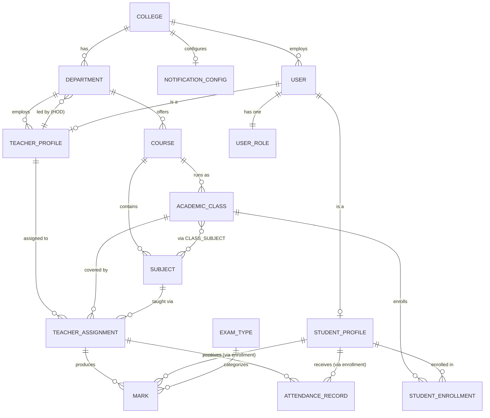
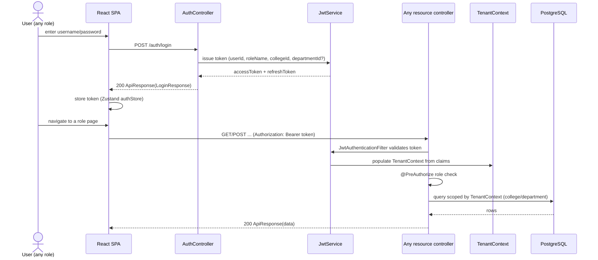
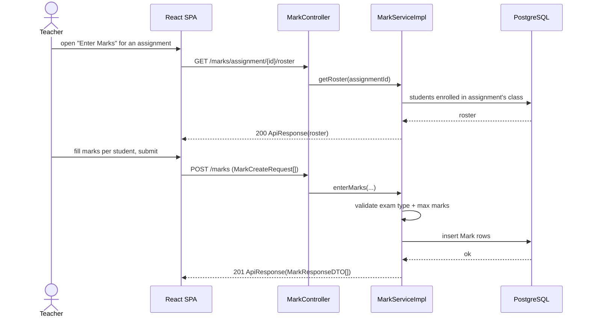
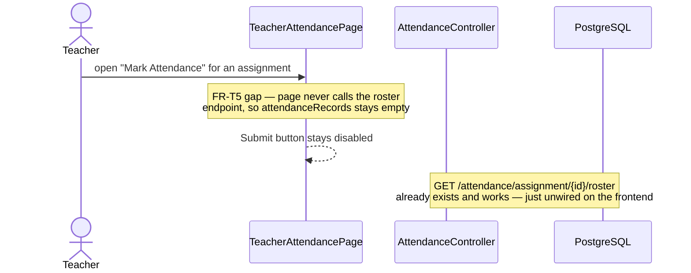
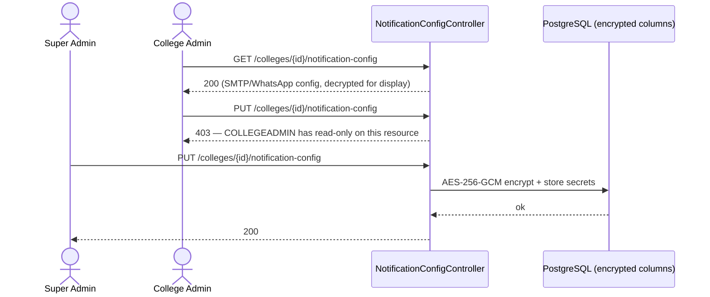

# Data Model & Interface Contracts

Full request/response payloads live in [docs/API.md](../API.md) (the
former `docs/APIdoc.md` duplicate was deleted — it had drifted and was
missing the Support/Observability sections `API.md` has; `API.md` is now
the single canonical copy). This doc is the
role-authorization map: which endpoint, which role, extracted directly from
each controller's `@PreAuthorize` (current as of commit `ed474e0`) — the
part existing docs don't make scannable in one place.

## Data model
Entities, by vertical-slice package (`com.edgepoint.<package>.domain`):

- **core** — `College`, `User`, `UserRole`, `AuditableEntity` (shared base:
  created/updated audit columns).
- **academic** — `Department`, `Course`, `Subject`, `AcademicClass`,
  `ClassSubject` (class↔subject join), `TeacherAssignment` (teacher↔class↔subject),
  `StudentEnrollment` (student↔class), `ExamType`, `Mark`.
- **attendance** — `AttendanceRecord`.
- **student** — `StudentProfile`.
- **teacher** — `TeacherProfile`.
- **notification** — `NotificationConfig` (SMTP/WhatsApp secrets, AES-256-GCM
  encrypted columns via `EncryptedStringConverter`).

Relationships: `College 1—N Department 1—N Course 1—N Subject`;
`AcademicClass N—N Subject` via `ClassSubject`; `TeacherAssignment` binds one
`TeacherProfile` to one `(AcademicClass, Subject)` pair — `Mark` and
`AttendanceRecord` are both keyed off a `TeacherAssignment` ("assignment" in
endpoint paths below means `TeacherAssignment`), not directly off
class/subject. `StudentEnrollment` binds a `StudentProfile` to an
`AcademicClass`.

### Entity-relationship diagram (LLD)

Not shown: `AuditableEntity` (created/updated-at columns, inherited by every
entity above, not a relationship). `MARK`/`ATTENDANCE_RECORD` reach a
student through `TEACHER_ASSIGNMENT` + `STUDENT_ENROLLMENT` on the same
`AcademicClass`, not through a direct foreign key — confirm this join is
indexed before adding a new per-student report endpoint, it's the one path
every student-facing read in [requirements.md](requirements.md) FR-S2/FR-S3
depends on.

## Interfaces — endpoint → role authorization map
All paths relative to `/api/v1`. "Class guard" = `@PreAuthorize` on the
controller (applies to every endpoint below it unless a method-level
override is noted).

| Controller | Base path | Class guard | Endpoint | Method override |
|---|---|---|---|---|
| `AuthController` | `/auth` | *(none — mixed)* | `POST /login` | Public |
| | | | `POST /refresh-token` | Public |
| | | | `POST /logout` | `isAuthenticated()` |
| | | | `POST /change-password` | `isAuthenticated()` |
| | | | `GET /validate-token` | `isAuthenticated()` |
| `CollegeController` | `/colleges` | `SUPERADMIN` | `POST/GET/GET{id}/PUT{id}/DELETE{id}`, `GET /{id}/statistics` | — |
| `NotificationConfigController` | `/colleges/{id}/notification-config` | *(none — mixed)* | `GET` | `SUPERADMIN, COLLEGEADMIN` |
| | | | `PUT` | `SUPERADMIN` only |
| `DepartmentController` | `/departments` | `SUPERADMIN, COLLEGEADMIN` | `POST /`, `PUT/{id}`, `POST /{id}/assign-hod`, `DELETE /{id}` | — |
| | | | `GET /` (list) | +`HOD` |
| | | | `GET /{id}` | class guard (no HOD) |
| `CourseController` | `/courses` | `SUPERADMIN, COLLEGEADMIN` | `POST /`, `PUT/{id}`, `DELETE/{id}` | — |
| | | | `GET /`, `GET /{id}` | +`HOD` |
| `SubjectController` | `/subjects` | `SUPERADMIN, COLLEGEADMIN, HOD` | `POST/GET/GET{id}/PUT{id}/DELETE{id}` | — |
| `ClassController` | `/classes` | `SUPERADMIN, COLLEGEADMIN, HOD` | `POST/GET/GET{id}`, `POST{id}/subjects`, `GET{id}/subjects`, `POST /teacher-assignments`, `GET{id}/teacher-assignments`, `DELETE{id}` | — |
| `EnrollmentController` | `/enrollments` | `SUPERADMIN, COLLEGEADMIN, HOD` | `POST /`, `GET /class/{id}` | — |
| `ExamTypeController` | `/exam-types` | *(none — mixed)* | `POST /` | `SUPERADMIN, COLLEGEADMIN` |
| | | | `GET /` | `SUPERADMIN, COLLEGEADMIN, HOD, TEACHER` |
| `StudentManagementController` | `/students` | `SUPERADMIN, COLLEGEADMIN, HOD` | `POST/GET/GET{id}/PUT{id}/DELETE{id}` | — |
| `TeacherManagementController` | `/teachers` | `SUPERADMIN, COLLEGEADMIN, HOD` | `POST/GET/GET{id}/PUT{id}/DELETE{id}` | — |
| `MarkController` | `/marks` | `SUPERADMIN, TEACHER` | `POST /`, `GET /assignment/{id}`, `GET /assignment/{id}/summary`, `PUT /{markId}`, `GET /assignment/{id}/roster` | — |
| `AttendanceController` | `/attendance` | `SUPERADMIN, TEACHER` | `POST /`, `GET /assignment/{id}`, `GET /assignment/{id}/summary`, `PUT /{id}`, `GET /my-assignments`, `GET /assignment/{id}/roster` | — |
| `TeacherDashboardController` | `/dashboard/teacher` | `SUPERADMIN, TEACHER` | `GET /` | — |
| `StudentMarkController` | `/student-marks` | `SUPERADMIN, STUDENT` | `GET /my-marks`, `GET /subject/{id}` | — |
| `StudentAttendanceController` | `/student-attendance` | `SUPERADMIN, STUDENT` | `GET /my-attendance`, `GET /subject/{id}` | — |
| `StudentProfileController` | `/profile` | `SUPERADMIN, STUDENT` | `GET /`, `PUT /` | — |
| `StudentDashboardController` | `/dashboard/student` | `SUPERADMIN, STUDENT` | `GET /` | — |
| `SupportController` | `/support` | `isAuthenticated()` | `POST /` | — |

**Not backed by a controller:** `frontend/src/api/institution.ts` calls
`/institutions` and `/institutions/:id` — no matching controller exists
anywhere in `backend/src/main/java/com/edgepoint`. Dead code today (only
referenced from the disconnected `components/edgepoint/` tree); will 404 the
moment that tree is wired up. See [requirements.md](requirements.md) FR-X3.

**Asymmetry worth a second look:** `DepartmentController`/`CourseController`
open their list+read endpoints to `HOD` via a method override but keep
create/update/delete at the class-level (`SUPERADMIN, COLLEGEADMIN`) guard —
consistent with `docs/ACCESS_CONTROL.md`'s "HOD is read-only on Departments"
note, but `CourseController` grants HOD read on courses too, which that same
table doesn't call out explicitly. Confirm this is intentional before
changing either controller's guard.

## Key sequence diagrams (LLD)

### Login → scoped request

### Teacher marks entry

### Attendance marking — current gap

Fixing FR-T5 ([requirements.md](requirements.md)) is wiring `FE` to call the
same roster endpoint the marks flow above already uses successfully, then
`POST /attendance` with the filled roster.

### Notification config — split-privilege write

## Privacy module contracts
Migration `V6__privacy_workflows.sql`. Every table carries `college_id`.

| Table | Purpose |
|---|---|
| `privacy_purposes` | Purposes per college (`CONSENT` or `LEGITIMATE_USE`, `withdrawable`) |
| `privacy_notices` | Versioned, immutable notice text |
| `consent_records` | Append-only consent ledger (`GRANTED`/`WITHDRAWN`) |
| `data_requests` | ACCESS / CORRECTION / ERASURE / GRIEVANCE requests with `due_at` |
| `data_request_events` | Status history per request |
| `retention_policies` | Per-college retention rules (ship disabled) |
| `retention_runs` | One row per retention run (`dry_run`, counts) |
| `privacy_audit_log` | Append-only privacy audit trail |

Also `users.anonymised_at TIMESTAMP`.

Endpoints, prefix `/privacy` (relative to `/api/v1`):

| Endpoint | Roles | Purpose |
|---|---|---|
| `GET /notice/current` | authenticated | Active notice and purposes |
| `GET /consents/me` | authenticated | My current consent per purpose |
| `POST /consents` | authenticated | Grant or withdraw one purpose |
| `POST /requests` | STUDENT, TEACHER | Raise a request |
| `GET /requests/me` | STUDENT, TEACHER | My requests |
| `GET /requests/{id}` | STUDENT, TEACHER | My request detail |
| `POST /requests/{id}/cancel` | requester | Cancel while `SUBMITTED` |
| `GET /requests/{id}/export` | requester | Download access bundle |
| `GET /admin/requests` | SUPERADMIN, COLLEGEADMIN | Queue with filters, overdue flag |
| `GET /admin/requests/{id}` | SUPERADMIN, COLLEGEADMIN | Request detail with events |
| `POST /admin/requests/{id}/review` | COLLEGEADMIN | Move to `IN_REVIEW`, assign |
| `POST /admin/requests/{id}/resolve` | COLLEGEADMIN | Complete, partially complete or reject |
| `GET`, `POST /admin/notices` | SUPERADMIN read; COLLEGEADMIN publish | List and publish notices |
| `GET`, `PUT /admin/retention-policies` | SUPERADMIN read; COLLEGEADMIN edit | Retention policies |
| `POST /admin/retention/run?dryRun=` | COLLEGEADMIN | On-demand run |
| `GET /admin/retention/runs` | SUPERADMIN, COLLEGEADMIN | Run history |
| `GET /admin/audit` | SUPERADMIN, COLLEGEADMIN | Privacy audit trail |

## Error handling conventions
- Every response is wrapped in a standard envelope:
  `{ success, message, data, timestamp }` (`ApiResponse`).
- Typed exceptions in `core.exception`, each with its own
  `@ExceptionHandler` in `GlobalExceptionHandler`: `AuthenticationException`,
  `BadRequestException` → 400, `BusinessRuleViolationException`,
  `DuplicateResourceException`, `ResourceNotFoundException` → 404,
  `UnauthorizedException`, `ValidationException`. Anything else falls
  through to a generic 500 handler.
- Historical gotcha (fixed): `BadRequestException` had no handler for a
  while and fell through to the 500 path — any new exception type added
  here needs its own `@ExceptionHandler`, or it silently becomes a 500.

## Planned/missing contracts (flagged, not yet designed)
These showed up as frontend mock data or prototype UI with no backend
counterpart — listed so new API work doesn't start from a blank page, but
not yet speced:
- Fee templates, invoices, student receipts, revenue reporting (billing).
- College suspension/plan management (beyond hard delete).
- Academic-year/term configuration per college.
